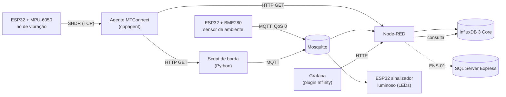

# Arquitetura de baixo custo para iniciação à Indústria 4.0

Material complementar do Trabalho de Conclusão de Curso **"Projeto e desenvolvimento de uma arquitetura de baixo custo para iniciação à Indústria 4.0 utilizando Node-RED, MQTT, banco de dados e Grafana"**.

- **Autor:** Iago Rathecke Ellwanger
- **Orientador:** Prof. André Francisco Caldeira
- **Instituição:** Universidade Federal de Santa Maria (UFSM), Campus Cachoeira do Sul, Curso de Engenharia Mecânica, 2026
- **Versão citada no TCC (Apêndice A):** `v1.1.0`

Este repositório reúne o material necessário para acompanhar e repetir a implementação e os ensaios descritos no trabalho: firmware dos nós, fluxos do Node-RED, script de computação de borda, configuração do agente MTConnect, scripts de carga e de monitoramento e os dados brutos dos ensaios ENS-01 a ENS-04.

> **Escopo.** O trabalho trata da concepção e da demonstração funcional de uma arquitetura em escala de bancada. Os ensaios são evidências complementares do funcionamento da arquitetura nas condições descritas, e não um estudo de desempenho computacional. Os dados dos sensores são demonstrativos e não foram calibrados nem validados metrologicamente. O limite de escalabilidade da arquitetura não foi determinado (Seção 5.2 do TCC).

## Conteúdo

```
.
├── firmwares_sensores/
│   ├── Sensor_iot_esp_MQTT_v2_Local/                   nó sensor de ambiente (ESP32 + BME280), MQTT
│   ├── Indicador_luminoso_esp_MQTT_v2/                 sinalizador luminoso (ESP32 + 3 LEDs), MQTT
│   └── sensor_edge_esp_MTConnect_2_timeseries_Local/   nó de vibração (ESP32 + MPU-6050), adapter MTConnect
├── mtconnect_config/     agent.cfg e Devices.xml do agente MTConnect (cppagent)
├── script_borda/         edge_node_2.py: script de computação de borda (RMS da vibração)
├── flow node-red/        fluxos de operação: coleta, consultas para o Grafana e painel auxiliar
├── ENS-01/               fluxo de escrita dos ensaios de carga e dados do ENS-01
├── ENS-02/               dados do ensaio de resiliência
├── ENS-03/               fluxo de latência e dados do ENS-03
└── ENS-04/               gerador de carga, monitor de recursos e dados (Dados/)
```

## Arquitetura



| Camada | Componente | Função |
|---|---|---|
| Aquisição | ESP32 (DevKit WROOM-32D) com BME280 e com MPU-6050 | Leitura de variáveis ambientais e de aceleração |
| Transporte | Eclipse Mosquitto (MQTT) e agente MTConnect | Mensageria dos sensores e padronização do dado de vibração |
| Processamento | Node-RED e script de borda em Python | Orquestração dos fluxos, cálculo de RMS e gravação |
| Persistência | InfluxDB 3 Core e SQL Server Express | Série histórica; o SQL Server foi usado apenas na comparação do ENS-01 |
| Visualização | Grafana | Painéis, alimentados por endpoints HTTP do Node-RED (plugin Infinity) |

O sinalizador luminoso assina o tópico do sensor de ambiente e acende o LED verde, amarelo ou vermelho. Os limiares são paramétricos e demonstrativos, sem vinculação a normas.

### Tópicos, portas e endpoints

| Item | Valor | Uso |
|---|---|---|
| Tópico MQTT | `casa/parametros/sensor1` | Sensor de ambiente → Node-RED e sinalizador luminoso |
| Tópico MQTT | `tcc/bancada/vibracao` | Script de borda → Node-RED |
| Tópico MQTT | `fabrica/teste/carga` | Gerador de carga → Node-RED (ENS-01 e ENS-04) |
| Porta 1883 | Mosquitto | MQTT sem TLS e sem autenticação |
| Porta 7878 (TCP, SHDR) | Nó de vibração | O agente conecta-se ao nó, que atua como adapter |
| Porta 5000 (HTTP) | Agente MTConnect | `/current` e `/sample`, consultados pelo Node-RED e pelo script de borda |
| Porta 8181 (HTTP) | InfluxDB 3 Core | Escrita pelo Node-RED e consultas SQL em `/api/v3/query_sql` |
| Porta 1880 (HTTP) | Node-RED | Endpoints lidos pelo Grafana: `/dadosAmbiente/ultimo`, `/dadosAmbiente/timeseries`, `/dadosVibracaoEdge/ultimo`, `/dadosVibracaoEdge/timeseries`, `/dadosVibracao/ultimo/x`, `/dadosVibracao/ultimo/y`, `/dadosVibracao/ultimo/z` e `/dadosVibracao/timeseries` |

### Formato das mensagens

**Sensor de ambiente** (a cada 5 s; `timestamp` em segundos, epoch UTC, relógio do ESP32 sincronizado por NTP):

```json
{"temperatura":22.32,"pressao":998.41,"umidade":72.85,"timestamp":1792878735}
```

**Nó de vibração → agente** (a cada 1 s, uma linha SHDR `TIME_SERIES` por eixo, com 256 amostras a 1 kHz, em mm/s²): `|acc_x|256|1000|v1 v2 ... v256`. O firmware não envia horário; o agente atribui à série o instante em que a recebe, associado à última amostra da janela. As janelas cobrem cerca de 25,6 % do tempo.

**Script de borda** (a cada 15 s): campos `sensor`, `timestamp` (horário da última amostra, vindo do agente), `aceleracao_rms_x`, `aceleracao_rms_y`, `aceleracao_rms_z` e `aceleracao_rms_global`, em mm/s². O RMS de cada eixo é calculado após subtrair a média do intervalo, o que atenua, sem eliminar completamente, o efeito da gravidade. O campo `aceleracao_rms_global` é um indicador agregado dos três eixos (raiz da soma dos quadrados), válido para a posição de montagem adotada. Apesar do nome, ele não representa a vibração global da máquina.

**Gerador de carga** (dados sintéticos; `timestamp_ns` em nanossegundos, epoch UTC, relógio do computador do gerador):

```json
{"client_id": "sensor_virtual_001", "timestamp_ns": 1791811793072355100, "vibracao_rms": 1.1424, "status_maquina": "NORMAL"}
```

### Bancos de dados

| Banco | Tabela / measurement | Origem |
|---|---|---|
| InfluxDB `dadosPrimarios` | `dadosAmbiente` | Sensor de ambiente (operação) |
| InfluxDB `dadosPrimarios` | `dadosVibracaoEdge` | Resumo publicado pelo script de borda |
| InfluxDB `dadosPrimarios` | `vibracao` e `vibracao_rms` | Amostras brutas consultadas ao agente e resumo por janela (RMS e pico), gravados pelo Node-RED |
| InfluxDB `testes_carga_2` | `teste_comparativo` | ENS-01, caminho de escrita para o InfluxDB |
| InfluxDB `base_tcc` | `dados_ambiente` e `latencia_f3` | ENS-03 |
| InfluxDB `base_tcc` | `teste_performance_<n>` | ENS-04 (nome alterado a cada rodada) |
| SQL Server `Banco_TCC_V1` | `analise_carga` | ENS-01, caminho de escrita para o SQL Server Express |

### Versões e ambiente

| Item | Versão / descrição |
|---|---|
| Eclipse Mosquitto | 2.0.15 |
| Node-RED | 5.0.0 |
| `node-red-contrib-influxdb3` | 1.1.1 |
| `node-red-contrib-mssql` | 0.0.7 (somente ENS-01) |
| `@flowfuse/node-red-dashboard` | 1.34.1 (somente `dash_node.json`) |
| InfluxDB 3 Core | 3.9.2 |
| SQL Server Express | 2022 |
| Grafana (Enterprise, versão gratuita) | 13.1.0, com o plugin Infinity |
| MTConnect cppagent | 2.8.0.3 (`SchemaVersion = 2.5`) |
| Firmware | Arduino IDE, placa ESP32; bibliotecas PubSubClient, ArduinoJson, Adafruit BME280 e Adafruit Unified Sensor |
| Python | `paho-mqtt` 2.x, `requests` e `psutil` |
| Estação de serviços | Windows, Intel Core i3 de 4 núcleos a 3,4 GHz, 8 GB de RAM DDR3, SSD |
| Gerador de carga | Outro computador, na mesma rede local |

Todos os serviços (Mosquitto, Node-RED, InfluxDB, SQL Server Express, Grafana e agente MTConnect) rodam de forma nativa em uma única estação. Todas as mensagens MQTT usam QoS 0.

### Carimbos de tempo

- A coluna `time` dos arquivos exportados do InfluxDB está em **UTC**.
- Os logs do gerador, o monitor serial do ESP32, os arquivos do monitor de recursos e a coluna `timestamp_banco` do SQL Server estão em **horário local (UTC−3)**.
- `timestamp` e `ts_sensor_ms` (sensor) e `timestamp_ns` (gerador) são epoch UTC.
- Nos dados do sensor de ambiente, o `time` do InfluxDB é o carimbo enviado pelo sensor. Quando o Node-RED grava sem informar horário (ENS-01, ENS-04 e measurement `latencia_f3` do ENS-03), o `time` é o instante atribuído na gravação, e não o carimbo de origem.
- Nos arquivos gravados pelo Node-RED, `timestamp_ns` perde os últimos dígitos por causa da precisão numérica do JavaScript. Para parear com o log do gerador, compare com resolução de milissegundos.

## Instalação e configuração

### Valores a substituir

Os arquivos usam valores genéricos no lugar dos dados da rede de ensaio. Substitua antes de gravar o firmware ou de executar os scripts:

| Valor | Onde |
|---|---|
| `NOME_DA_REDE` e `SENHA_DA_REDE` | Os três firmwares |
| `IP_DO_BROKER` | `Sensor_iot_esp_MQTT_v2_Local.ino`, `Indicador_luminoso_esp_MQTT_v2.ino` e `BROKER_ADDRESS` em `ENS-04/gerador_carga_v2.py` |
| IP fixo do nó de vibração (`local_IP`, `gateway`, `subnet`) | Firmware MTConnect; deve coincidir com `Host` em `mtconnect_config/agent.cfg` |
| Caminhos `C:\...` dos nós *file* | `ENS-01/escrita_MSSQL_INFLUX.json` |
| Usuário e senha do SQL Server | Nó de configuração `MSSQL-CN` no Node-RED (não são exportados com o fluxo) |

### Mosquitto

No `mosquitto.conf`:

```
listener 1883
allow_anonymous true
```

Libere a porta 1883 no firewall do Windows.

### InfluxDB 3 Core

Na bancada, o InfluxDB foi iniciado sem autenticação. Exemplo de inicialização e criação do banco de operação (ajuste os parâmetros à versão instalada):

```powershell
influxdb3 serve --node-id bancada --object-store file --data-dir C:\influxdb3\data --without-auth
influxdb3 create database dadosPrimarios
```

Para repetir os ensaios, crie também `testes_carga_2` e `base_tcc`. As tags de cada tabela devem ser definidas na primeira escrita e não podem ser alteradas depois.

### Agente MTConnect

Na pasta do cppagent, com `agent.cfg` e `Devices.xml`:

```powershell
agent run agent.cfg
```

O agente responde em `http://localhost:5000/current` e `http://localhost:5000/sample`.

### Node-RED

1. Instale as paletas `node-red-contrib-influxdb3`, `node-red-contrib-mssql` (somente para o ENS-01) e `@flowfuse/node-red-dashboard` (somente para o painel auxiliar).
2. Importe os fluxos e confira, nos nós de configuração, o broker (`localhost:1883`) e o InfluxDB (`http://localhost:8181`).

| Fluxo | Função |
|---|---|
| `flow node-red/Coleta_sensores.json` (aba `Coleta_sensores_TCCB`) | Três ramos de persistência em `dadosPrimarios`. **Sensor de ambiente:** MQTT → tratamento → InfluxDB. **Resumo de borda:** MQTT → InfluxDB. **Nó de vibração:** consulta `/sample` ao agente a cada 1 s, reconstrói de forma aproximada o horário de cada amostra (carimbo do agente na última amostra, recuando 1 ms por amostra), calcula RMS e pico por janela após subtrair a média e grava em lotes de até 5.000 pontos, para não ultrapassar o limite de 10 MB por escrita |
| `flow node-red/Consulta_influxdb.json` (aba `Consulta_InfluxDB`) | Oito endpoints HTTP, em três grupos (ambiente, resumo de borda e vibração bruta), que consultam o InfluxDB e entregam o resultado ao Grafana. As consultas de vibração convertem a aceleração de mm/s² para m/s² |
| `flow node-red/dash_node.json` (aba `MPU6050 MTConnect`) | Painel auxiliar de depuração do agente MTConnect no Node-RED Dashboard 2.0 (`http://localhost:1880/dashboard/mpu6050`). Não foi usado nos ensaios nem é descrito no TCC. Com o firmware atual, os grupos de giroscópio e temperatura ficam sem dados |
| `ENS-01/escrita_MSSQL_INFLUX.json` (aba `Teste_Carga`) | Fluxo dos ensaios de carga ENS-01 e ENS-04 (ver os ensaios) |
| `ENS-03/latencia_ens3.json` | Fluxo do ENS-03 (ver o ensaio). A aba tem o mesmo nome do fluxo de operação; renomeie-a ao importar na mesma instância do Node-RED |

### Grafana

Instale o plugin Infinity e crie consultas do tipo URL apontando para os endpoints do Node-RED, por exemplo `http://localhost:1880/dadosAmbiente/timeseries`. Os horários vêm em UTC; o Grafana os converte para o fuso configurado nele.

### Script de borda

```powershell
pip install requests paho-mqtt
python script_borda/edge_node_2.py
```

O script roda na estação de serviços: consulta o agente em `localhost:5000` a cada 15 s e publica o resumo em `tcc/bancada/vibracao` no broker local. Na bancada, o Node-RED e o script de borda precisaram ser iniciados manualmente a cada religamento da estação (Seção 4.1).

## Ensaios: onde estão os dados

| Ensaio | Data | O que foi medido | No TCC | Script / firmware | Fluxo Node-RED |
|---|---|---|---|---|---|
| ENS-01 | 12/10/2026 | 50 publicadores virtuais (≈ 50 msg/s), 1 h para cada caminho de escrita (InfluxDB e SQL Server Express) | Seções 3.5.1, 4.4.1, 4.5 e 4.6; Tabela 6; Figura 19 | Gerador de carga (versão anterior ao v2; ver abaixo) | `ENS-01/escrita_MSSQL_INFLUX.json`, ramos SQL e InfluxDB |
| ENS-02 | 24/10/2026 | Nó sensor físico, cinco interrupções provocadas do Wi-Fi em 43 min | Seções 3.5.2 e 4.4.2; Tabela 5; Figura 18 | `Sensor_iot_esp_MQTT_v2_Local` | Ramo do sensor de ambiente |
| ENS-03 | 24/10/2026 | Diferença temporal aparente e completude da série, nó sensor físico, 189 mensagens | Seções 3.5.3 e 4.6; Tabela 7; Figura 20 | Firmware modificado, não preservado (ver abaixo) | `ENS-03/latencia_ens3.json` |
| ENS-04 | 16/11/2026 (2ª execução) | 10, 50 e 100 publicadores (2, 10 e 20 msg/s), 10 min por rodada, com CPU e memória | Seções 3.5.4 e 4.7; Tabela 8; Figura 21 | `ENS-04/gerador_carga_v2.py` e `ENS-04/monitor_recursos_v2.py` | `ENS-01/escrita_MSSQL_INFLUX.json`, ramo do ENS-04 |

Nos ensaios com gerador de carga, a entrega é contada em três pontos, com rótulos distintos:

- **tentadas:** registro do gerador (em QoS 0 não há confirmação de entrega ao broker);
- **recebidas:** arquivo gravado pelo Node-RED;
- **recuperadas:** registros encontrados por consulta ao banco ao final da rodada.

"100 %" significa que as três contagens coincidem.

### ENS-01

Rodada InfluxDB das 09:14:50 às 10:14:49 e rodada SQL Server das 10:29:53 às 11:29:52 (horário local).

**Gerador.** Os logs foram produzidos por uma versão anterior do `gerador_carga_v2.py`, que não registrava o retorno da publicação (`rc`) nem o log de eventos; o payload é o mesmo. Para repetir com o v2, altere no início do arquivo `PUBLISH_INTERVAL_SEC = 1` e `MAX_RUNTIME_SEC = 3600` e execute, por exemplo, `python gerador_carga_v2.py INFLUX 50` e, depois, `python gerador_carga_v2.py SQL 50`.

**Fluxo** `escrita_MSSQL_INFLUX.json`:

- **Ramo SQL:** `mqtt in` → nó MSSQL com um `INSERT` por mensagem na tabela `analise_carga`, sem agrupamento em lotes; em paralelo, um nó *file* grava cada mensagem recebida.
- **Ramo InfluxDB:** `mqtt in` → função que separa `client_id` e `status_maquina` como tags e `vibracao_rms` como campo → escrita em `testes_carga_2`, measurement `teste_comparativo`, uma mensagem por escrita; em paralelo, um nó *file*.
- Habilite um ramo por rodada. No arquivo exportado, os dois ramos do ENS-01 estão desabilitados e o ramo do ENS-04 está ativo.

| Arquivo | Conteúdo | Registros |
|---|---|---|
| `log_dados_enviados_influx.txt`, `log_dados_enviados_sql.txt` | Gerador: tentativas de publicação | 179.867 / 179.893 |
| `dados_nodered_influx.txt`, `dados_nodered_sql.txt` | Node-RED: mensagens recebidas, uma por linha (no fluxo, `dados_influx.txt` e `dados.txt`) | 179.867 / 179.893 |
| `dados_inserido_influx.csv` | InfluxDB: registros recuperados (`time` = instante de gravação, UTC) | 179.867 |
| `dados_inseridos_sql.csv` | SQL Server: registros recuperados; saída de texto do SSMS, em colunas de largura fixa (`timestamp_banco` em horário local) | 77.250 |

Estrutura equivalente da tabela do SQL Server, reconstruída a partir da exportação (o fluxo insere os valores como texto):

```sql
CREATE TABLE analise_carga (
    ID              INT IDENTITY(1,1) PRIMARY KEY,
    client_id       VARCHAR(50),
    timestamp_banco DATETIME DEFAULT GETDATE(),
    vibracao_rms    VARCHAR(50),
    status_maquina  VARCHAR(50)
);
```

**Dispersão sob carga (Seção 4.6).** Calculada com os dados do caminho InfluxDB: para cada mensagem, `time` − `timestamp_ns`, menos o menor valor da mesma janela de 1 min, o que remove o desvio entre os relógios do gerador e da estação, admitido constante nesse intervalo. Nenhum valor foi excluído. Resultado: mediana de 2,4 ms, p95 de 10,0 ms, p99 de 25,8 ms e máximo de 330 ms. A estatística é a dispersão em relação ao mínimo da janela, e não o jitter de rede em sentido estrito.

### ENS-02

24/10/2026, das 18:52 às 19:35 (horário local). O firmware `Sensor_iot_esp_MQTT_v2_Local` registra no monitor serial, com data e hora, as quedas e os restabelecimentos do Wi-Fi e do MQTT e verifica as conexões a cada 10 s.

| Arquivo | Conteúdo | Registros |
|---|---|---|
| `Log_Serial_Arduino.txt` | Monitor serial do nó (horário local): publicações, quedas e retornos do Wi-Fi e do MQTT | 449 publicações |
| `dados_teste_resiliencia.csv` | Registros recuperados do InfluxDB (`time` = carimbo do sensor, UTC) | 439 |

Eram esperadas 516 mensagens em 2.577 s. Das 77 ausentes, 10 foram publicadas entre a queda e a sua detecção e não foram gravadas (QoS 0), e 67 não chegaram a ser geradas, porque o firmware não lê nem armazena dados enquanto está desconectado. As lacunas e perdas por evento estão na Tabela 5.

### ENS-03

24/10/2026, das 20:16:57 às 20:32:37 (horário local), 189 mensagens.

**Firmware.** O firmware modificado usado neste ensaio não foi preservado. Ele correspondia ao `Sensor_iot_esp_MQTT_v2_Local` com dois campos a mais no payload: `seq` (contador sequencial) e `ts_sensor_ms` (instante da publicação em milissegundos, epoch UTC, relógio sincronizado por NTP), que define T0. O formato esperado está documentado na função do fluxo `latencia_ens3.json`.

**Fluxo.** Ramo paralelo a partir do mesmo `mqtt in`. A função registra T2 = `Date.now()`, pelo relógio da estação, também sincronizado por NTP, e calcula `lat_sensor_nodered_ms` = T2 − T0. A escrita não informa horário, de modo que o `time` do ponto é o instante atribuído na gravação (T3), que não é confirmação de persistência. O ramo original grava os mesmos dados em `dados_ambiente`.

| Arquivo | Conteúdo |
|---|---|
| `dados_latencia_f3.csv` | Measurement `latencia_f3`. Cada mensagem ocupa duas linhas: uma com os campos (`seq`, `ts_sensor_ms` = T0, `ts_nodered_ms` = T2, `lat_sensor_nodered_ms`, temperatura, pressão e umidade) e outra só com as tags (`ensaio` = F3_A, `sensor` = BME280), porque a função envia `[campos, tags]`. Use as linhas com `seq`; `time` = T3, em UTC |
| `dados_ambiente_inseridos_Teste_latencia.csv` | Ramo original: 189 registros (`time` = carimbo do sensor, UTC) |

T2 − T0 compara dois relógios distintos e inclui a incerteza de sincronização entre eles; por isso é chamada de diferença temporal aparente (latência aparente).

### ENS-04

Estão publicados somente os dados da **2ª execução**: 16/11/2026, R10 das 20:16 às 20:26, R50 das 20:29 às 20:39 e R100 das 20:42 às 20:52 (horário local). Na 1ª execução (24/10/2026), 59 mensagens da rodada R10 não foram encontradas, sem causa identificada; esses dados não estão no repositório (Seção 4.7). A repetição com entrega integral não explica a ocorrência anterior nem constitui avaliação de repetibilidade.

**Fluxo.** Ramo do ENS-04 em `escrita_MSSQL_INFLUX.json`: `mqtt in` → escrita no InfluxDB `base_tcc`, measurement `teste_performance_<n>` (nome alterado a cada rodada); em paralelo, nó *file* `dados_recebidos_nodeRED.txt`. Os ramos do ENS-01 ficaram desabilitados; o SQL Server Express permaneceu em execução, sem receber gravações. As rodadas foram executadas com o nome de rodada `teste`, e os arquivos foram renomeados ao fim de cada uma (por isso os logs de eventos registram `rodada=teste`).

Arquivos em `ENS-04/Dados/`:

| Conteúdo | R10 (2 msg/s) | R50 (10 msg/s) | R100 (20 msg/s) |
|---|---|---|---|
| Gerador: tentativas, com o `rc` de cada publicação | `log_dados_enviados_teste_r10.txt` | `log_dados_enviados_teste_r50.txt` | `log_dados_enviados_teste_r100.txt` |
| Gerador: conexões, desconexões e falhas de publicação | `log_eventos_teste_r10.txt` | `log_eventos_teste_r50.txt` | `log_eventos_teste_r100.txt` |
| Node-RED: mensagens recebidas | `dados_recebidos_nodeRED_R10.txt` | `dados_recebidos_nodeRED_50.txt` | `dados_recebidos_nodeRED_r100.txt` |
| InfluxDB: registros recuperados | `influx_resultados_r10.csv` | `influx_resultados_r50.csv` | `influx_resultados_r100.csv` |
| CPU e memória por serviço | `recursos_teste_R10.csv` | `recursos_teste_50.csv` | `recursos_teste_r100.csv` |
| Os 5 processos com maior CPU, por amostra | `top5_teste_R10.csv` | `top5_teste_50.csv` | `top5_teste_r100.csv` |
| Tentadas / recebidas / recuperadas | 1.200 / 1.200 / 1.200 | 6.000 / 6.000 / 6.000 | 12.000 / 12.000 / 12.000 |

Medição de referência sem carga (Repouso, 3 min, das 21:15 às 21:18): `recursos_teste_3min.csv` e `top5_teste_3min.csv`.

**Convenções dos arquivos de recursos:**

- O total da estação (`cpu_total_pct`) é a média dos núcleos lógicos. O valor de cada serviço é o tempo de CPU dos seus processos dividido pelo número de núcleos lógicos, de modo que os dois ficam na mesma base: 0 a 100 % da capacidade da estação. A coluna `outros_cpu_pct` é o restante.
- O monitor grava uma amostra a cada ~1,5 s (intervalo de 1 s mais o tempo de varredura dos processos).
- As médias da Tabela 8 foram calculadas entre a primeira e a última publicação do gerador em cada rodada (horários em `log_dados_enviados_*`).
- A soma dos serviços da arquitetura inclui Mosquitto, Node-RED, InfluxDB, Grafana e agente MTConnect. O SQL Server Express aparece nos arquivos com cerca de 1 % da CPU da estação em todas as rodadas e em repouso, mas não entra nessa soma.
- O Grafana estava em execução, sem consultas de painéis.
- O próprio monitor (`python.exe` em `top5_*`) consome cerca de 8 % da CPU da estação. Esse consumo e o de aplicativos do operador entram na CPU total, que por isso não mede a arquitetura (Seção 4.7).

#### Como repetir o ENS-04

1. Na estação de serviços, deixe Mosquitto, InfluxDB e Node-RED em execução, com `escrita_MSSQL_INFLUX.json` importado, somente o ramo do ENS-04 habilitado e o measurement da rodada ajustado.
2. Na estação de serviços, inicie o monitor (de preferência como administrador):
   ```powershell
   pip install psutil
   python monitor_recursos_v2.py R10
   ```
3. No outro computador, ajuste `BROKER_ADDRESS` em `gerador_carga_v2.py` e inicie a rodada informando o nome e o número de publicadores:
   ```powershell
   pip install paho-mqtt
   python gerador_carga_v2.py R10 10
   ```
   Cada publicador envia uma mensagem a cada 5 s, em QoS 0, no tópico `fabrica/teste/carga`, durante 600 s. O gerador grava `log_dados_enviados_R10.txt` e `log_eventos_R10.txt`.
4. Ao fim da rodada, pare o monitor com `Ctrl+C`; ele grava `recursos_R10.csv` e `top5_R10.csv`.
5. Exporte os registros do InfluxDB, por exemplo pela API HTTP: `GET http://localhost:8181/api/v3/query_sql?db=base_tcc&format=csv&q=SELECT * FROM "teste_performance_10"`, com a consulta codificada na URL.
6. Repita para R50 (`python gerador_carga_v2.py R50 50`) e R100 (`python gerador_carga_v2.py R100 100`).

Os publicadores são iniciados de forma sincronizada, de modo que a carga chega em rajadas periódicas; as taxas em msg/s são médias.

## Resultados em resumo

Valores para a bancada descrita e a faixa ensaiada; detalhes e limitações estão no TCC.

- **ENS-01:** o Node-RED recebeu todas as mensagens tentadas nas duas rodadas (179.867 e 179.893), a cerca de 50 msg/s. Nas configurações testadas, o caminho de escrita para o InfluxDB 3 Core teve 100 % das mensagens recuperadas por consulta. O caminho para o SQL Server Express, com um `INSERT` por mensagem, teve 42,9 % (77.250), com recuperação por sensor de 17,7 % a 88,8 % e lacunas de até 227 s. Para as demais mensagens não houve confirmação de gravação, e a causa não foi determinada. O resultado não estabelece superioridade geral entre os bancos (Seção 4.5).
- **ENS-02:** recuperação automática nas cinco interrupções, entre 1 s e 10 s após o retorno da rede; 439 de 516 mensagens esperadas foram gravadas (85,1 %). Os dados do período de queda não são preservados (QoS 0, sem *buffer* no firmware).
- **ENS-03:** diferença temporal aparente entre a publicação no sensor e a chegada ao Node-RED (T2 − T0) com mediana de 150 ms e máximo de 242 ms; 189 de 189 mensagens em sequência. O valor inclui a incerteza de sincronização entre os relógios e não é medição isolada do tempo de trânsito.
- **ENS-04 (2ª execução):** 1.200, 6.000 e 12.000 mensagens tentadas, recebidas e recuperadas, conferidas uma a uma. Os serviços da arquitetura somaram cerca de 0,2 %, 0,7 % e 1,2 % da CPU da estação. Não houve indício de saturação na faixa ensaiada, mas o limite não foi determinado.
- **Script de borda:** em um intervalo de 15 s, o script consulta cerca de 276 kB de amostras textuais e publica uma mensagem-resumo de cerca de 193 bytes; a razão entre os tamanhos é da ordem de 1.400. Os dados não são equivalentes: o resumo contém indicadores, não substitui a série bruta (que também é gravada pelo Node-RED, measurement `vibracao`) e não mede economia de rede.

## Limitações

- Bancada com uma única estação de trabalho e rede Wi-Fi local; ensaios de no máximo duas horas contínuas; sem ensaio de falha de alimentação; arquitetura não instalada em ambiente industrial.
- Não se avaliou a repetibilidade dos resultados, e o limite de capacidade da arquitetura não foi determinado (50 msg/s no ENS-01; consumo de recursos medido até 20 msg/s no ENS-04).
- O acelerômetro não foi calibrado nem comparado com instrumento de referência. Os valores de aceleração servem para avaliar o fluxo de dados, não para diagnosticar máquinas.
- Os nós são protótipos de bancada e não equivalem a um CLP industrial certificado. A adaptação a painel industrial exige avaliação de proteção elétrica, compatibilidade eletromagnética, isolamento, grau de proteção, alimentação e segurança.
- O firmware modificado do ENS-03 e os dados da 1ª execução do ENS-04 não estão no repositório.

## Segurança

A configuração é laboratorial: MQTT sem TLS e sem autenticação na porta 1883, InfluxDB sem autenticação, editor do Node-RED sem senha, credenciais de Wi-Fi gravadas no firmware e rede de dispositivos sem segmentação. **Não use esta configuração em ambiente produtivo.** As medidas de mitigação recomendadas estão na Seção 4.8. Não versione credenciais reais; mantenha os valores genéricos indicados em "Valores a substituir".

## Como citar

ELLWANGER, Iago Rathecke. **Projeto e desenvolvimento de uma arquitetura de baixo custo para iniciação à Indústria 4.0 utilizando Node-RED, MQTT, banco de dados e Grafana**. 2026. Trabalho de Conclusão de Curso (Graduação em Engenharia Mecânica) – Universidade Federal de Santa Maria, Campus Cachoeira do Sul, Cachoeira do Sul, 2026.

Repositório: https://github.com/iagoellwanger-ufsm/Arquitetura_Industria_4.0, versão `v1.1.0`.
